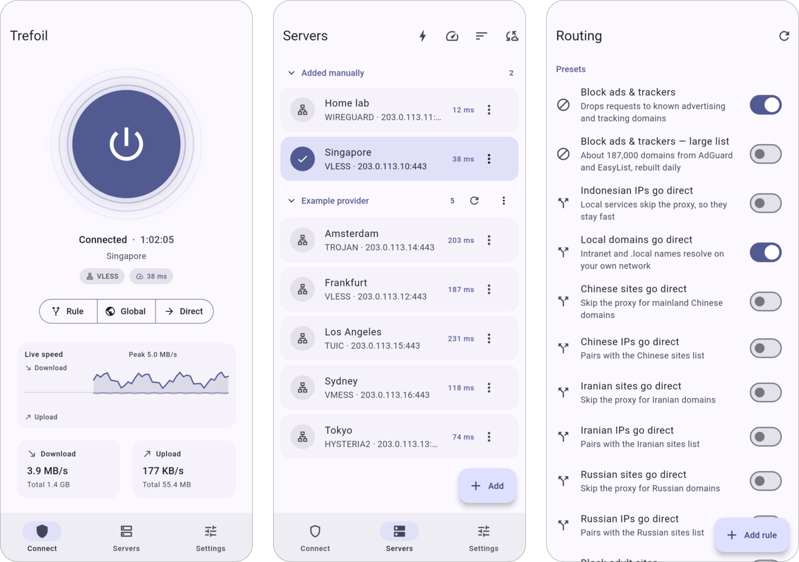

# Trefoil

A proxy client for Android. It runs three cores side by side, which is where the name
comes from: **sing-box**, **Xray-core** and **amneziawg-go**.

[](https://github.com/LostTheCodeInside/trefoil/actions/workflows/ci.yml)
[](https://github.com/LostTheCodeInside/trefoil/releases/latest)
[](LICENSE)

<picture>
  <source media="(prefers-color-scheme: dark)" srcset="docs/screenshots/overview-dark.png">
  
</picture>

## Install

1. Download the APK for your phone from the [latest release](https://github.com/LostTheCodeInside/trefoil/releases/latest).
   `arm64-v8a` fits almost any phone made since 2017.
2. Open it, and allow your browser or file manager to install apps when Android asks.

It needs Android 7.0 or newer. From then on the app updates itself: it checks the
releases here once per launch, and installs an update only when its hash, version and
signing key match.

## Features

- **Servers.** Subscriptions (link list, base64 or Clash/Meta YAML), share links, QR
  codes, and WireGuard or AmneziaWG `.conf` files. Protocols: `vless` (incl. REALITY),
  `vmess`, `trojan`, `ss`, `hysteria`, `hysteria2`, `tuic`, `anytls`, `socks` and
  `wireguard`.
- **Switching without reconnecting.** Latency tests and server changes happen on the
  live tunnel.
- **Routing.** Per-app control, ad-blocking and direct-routing presets, and your own
  rules by domain, IP range or app. A rule can proxy, go direct, block, use a chosen
  server, or go through Cloudflare WARP.
- **Around the tunnel.** Quick Settings tile, home screen widget, live speed in the
  notification, a connections view, per-server traffic totals and encrypted backups.
- **Eight languages.** English, Indonesian, Chinese, Persian, Russian, Arabic,
  Vietnamese and Turkish.

## Stack

| | Layer | What runs there |
|:-:|---|---|
|  | UI | Flutter 3.47, Dart, Material 3 |
|  | Bridge | Kotlin, `MethodChannel` and `EventChannel` |
|  | Tunnel | Android `VpnService`, as a foreground service |
|  | Cores | sing-box 1.14.4, Xray-core v26.10.21 and amneziawg-go v3, compiled into one gomobile `.aar` |

sing-box carries every tunnel. Xray-core and amneziawg-go take the servers it cannot
run (post-quantum REALITY, AmneziaWG) behind a loopback proxy that sing-box dials, so
DNS, routing and per-app rules stay in one place.

## Build

```bash
./scripts/build-cores.sh             # the native cores, about 15 minutes
flutter pub get
flutter build apk --split-per-abi
```

Requirements, releases, tests and CI are in [docs/BUILDING.md](docs/BUILDING.md).
Changes are in [CHANGELOG.md](CHANGELOG.md).

## License

[GPL-3.0-or-later](LICENSE). The projects it builds on are listed with their licenses
in [THIRD_PARTY_LICENSES.md](THIRD_PARTY_LICENSES.md).

Trefoil is an independent project. It is not affiliated with or endorsed by the
sing-box, Xray or AmneziaVPN projects.
